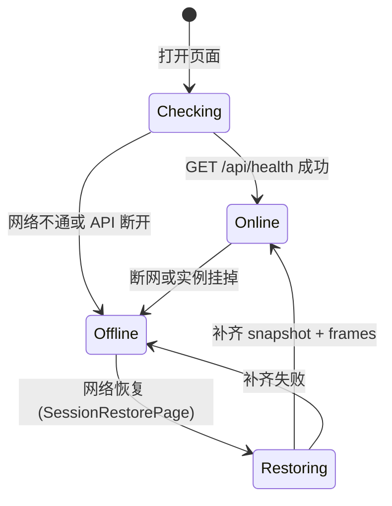

# Unison 核心状态图

## 一、端连接状态流转

## 二、生成任务状态流转
```mermaid
stateDiagram-v2
    [*] --> InProgress: POST /questions 受理
    InProgress --> Confirmed: 生成结束，分配新版本（落库）
    InProgress --> Interrupted: POST /interrupt 或 被打断
    InProgress --> TakenOver: 持有实例挂掉，其他实例接管
    TakenOver --> Confirmed: 补齐收尾，仍产出一次完整 confirm
    Confirmed --> [*]
    Interrupted --> [*]